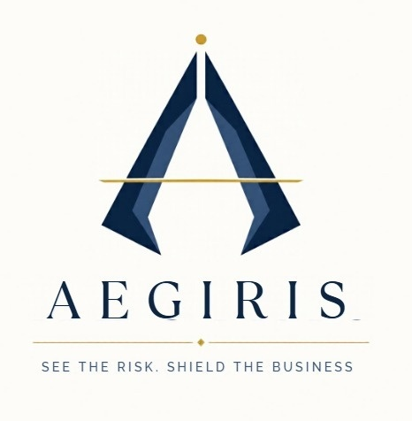
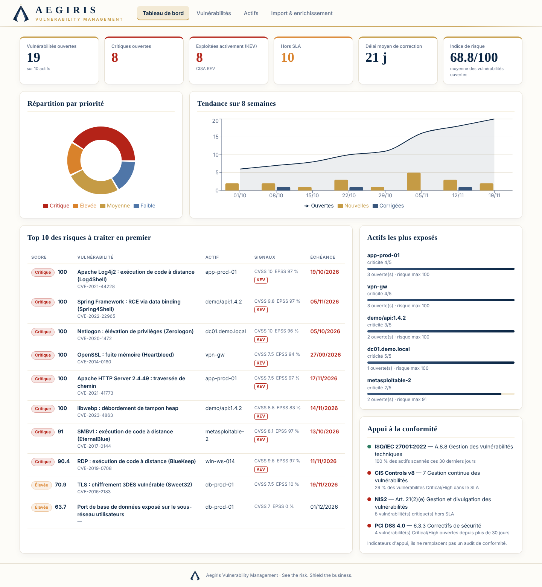
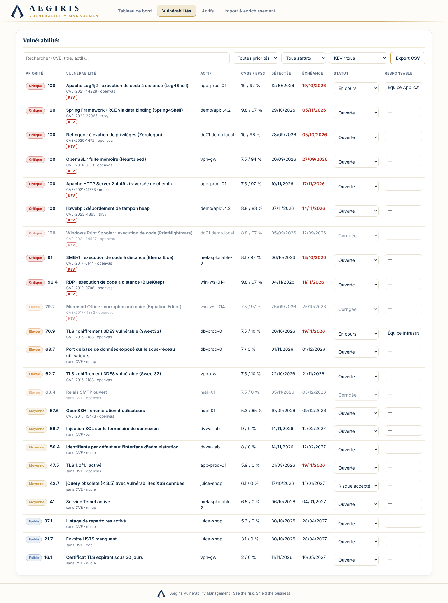
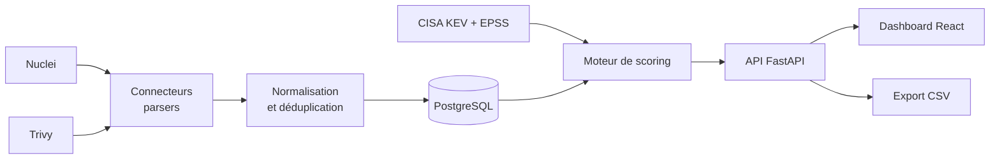

<p align="center">
  
</p>

# Aegiris Vulnerability Management

*See the risk. Shield the business.*

Plateforme open source de **gestion des vulnérabilités** : elle centralise les résultats de scanners gratuits (Nuclei, Trivy, et d'autres à venir), les enrichit avec des sources publiques (CISA KEV, EPSS), calcule un **score de risque priorisé** et suit la **remédiation** avec des SLA, dans un dashboard React.

> Aegiris n'est pas un scanner : c'est la couche d'orchestration, de priorisation et de reporting au-dessus des scanners.


## Aperçu





*Captures réalisées avec les données de démonstration fictives.*

## Fonctionnalités

- **Import** des résultats Nuclei (JSONL) et Trivy (JSON), avec création automatique des actifs
- **Déduplication** : une même CVE vue par plusieurs scanners sur un actif = une seule vulnérabilité ; une vulnérabilité corrigée puis revue est rouverte
- **Enrichissement** CISA KEV (vulnérabilités exploitées activement) et EPSS (probabilité d'exploitation)
- **Scoring de risque** 0-100 combinant CVSS, EPSS, KEV et criticité de l'actif
- **Workflow de remédiation** : ouverte, en cours, corrigée, risque accepté, avec responsable et échéance (SLA par priorité)
- **Dashboard** : KPI, répartition par priorité, tendance sur 8 semaines, top risques, actifs les plus exposés
- **Indicateurs d'appui à la conformité** : ISO 27001 A.8.8, CIS Controls 7, NIS2 art. 21, PCI DSS 6.3.3
- **Export CSV** pour les rapports
- **Garde-fou légal** : chaque actif porte une référence d'autorisation de scan

## Architecture



| Dossier | Rôle |
|---|---|
| `backend/app/connectors` | Un parser par scanner (sortie brute vers findings normalisés) |
| `backend/app/scoring.py` | Calcul du score, de la priorité et des échéances SLA |
| `backend/app/ingest.py` | Import, déduplication, réouverture |
| `backend/app/enrichment.py` | Appels CISA KEV et FIRST EPSS |
| `backend/app/analytics.py` | KPI, tendances, indicateurs de conformité |
| `frontend/` | Dashboard React (Vite + Recharts) |
| `samples/` | Exemples de sorties Nuclei et Trivy |

## Méthode de scoring

```
score = min(100, (CVSS × 7 + EPSS × 20 + 25 si KEV) × multiplicateur_criticité)
```

| Criticité de l'actif | 1 | 2 | 3 | 4 | 5 |
|---|---|---|---|---|---|
| Multiplicateur | 0,8 | 0,9 | 1,0 | 1,15 | 1,3 |

| Score | Priorité | SLA de remédiation |
|---|---|---|
| ≥ 80 | Critique | 7 jours |
| ≥ 60 | Élevée | 30 jours |
| ≥ 40 | Moyenne | 90 jours |
| < 40 | Faible | 180 jours |

Une vulnérabilité exploitée activement (KEV) sur un actif critique passe donc devant une vulnérabilité à CVSS élevé mais jamais exploitée. Les pondérations sont des constantes en tête de `scoring.py`, faciles à adapter à votre politique de gestion des risques.

## Démarrage rapide

### Avec Docker

```bash
cp .env.example .env        # puis changez POSTGRES_PASSWORD
docker compose up --build
```

- Dashboard : http://localhost:8080
- API et documentation interactive : http://localhost:8000/docs

Au premier démarrage, `SEED_DEMO=true` charge des données **fictives** de démonstration (mettez `false` pour une base vide).

### En développement

```bash
# Backend (SQLite par défaut)
cd backend
python -m venv .venv && source .venv/bin/activate
pip install -r requirements-dev.txt
SEED_DEMO=true uvicorn app.main:app --reload
pytest

# Frontend
cd frontend
npm install
npm run dev                 # http://localhost:5173 (proxy vers l'API sur :8000)
```

## Utilisation

```bash
# 1. Scanner une cible dont vous avez l'autorisation (ex. une cible de lab)
nuclei -u https://cible-autorisee.example -jsonl -o resultats.jsonl
trivy image -f json -o rapport.json mon-image:tag

# 2. Importer (ou utiliser l'onglet « Import & enrichissement »)
curl -X POST localhost:8000/api/import/nuclei --data-binary @resultats.jsonl
curl -X POST localhost:8000/api/import/trivy  --data-binary @rapport.json

# 3. Enrichir avec CISA KEV et EPSS (accès Internet requis)
curl -X POST localhost:8000/api/enrich
```

## API

| Méthode | Route | Description |
|---|---|---|
| GET | `/api/dashboard/summary` | KPI, tendances, top risques, conformité |
| GET | `/api/vulnerabilities` | Liste filtrable (`status`, `priority`, `kev`, `asset_id`, `q`) |
| PATCH | `/api/vulnerabilities/{id}` | Changer le statut ou le responsable |
| GET / POST | `/api/assets` | Inventaire des actifs |
| PATCH | `/api/assets/{id}` | Modifier la criticité (recalcule les scores) |
| POST | `/api/import/{nuclei\|trivy}` | Importer la sortie brute d'un scanner |
| POST | `/api/enrich` | Enrichir via CISA KEV et EPSS |
| GET | `/api/report.csv` | Export CSV |

## Feuille de route

- [ ] Connecteurs OpenVAS/Greenbone, OWASP ZAP, Nmap
- [ ] Authentification, RBAC et multi-organisations
- [ ] Rapports PDF en français (direction, auditeurs)
- [ ] Mapping de conformité local (BCT, ANCS, INPDP) et NIS2 détaillé
- [ ] Intégrations de ticketing (Jira, GLPI) et alertes (mail, Teams)
- [ ] Planification des scans et vérification de la propriété des cibles

## Sécurité et usage responsable

- Ne scannez que des systèmes pour lesquels vous disposez d'une **autorisation écrite**.
- Les données de démonstration sont fictives. Les valeurs EPSS du jeu de démo sont indicatives ; lancez l'enrichissement pour obtenir les valeurs réelles.
- Les indicateurs de conformité sont des aides au pilotage et ne remplacent pas un audit.
- Avant une mise en production : ajoutez l'authentification, activez HTTPS devant l'application et changez tous les mots de passe par défaut.

## Licence

MIT, voir [LICENSE](LICENSE). Les outils externes (Nuclei, Trivy, OpenVAS/Greenbone, etc.) restent soumis à leurs propres licences : Aegiris les utilise comme programmes externes dont il lit les sorties et ne les redistribue pas.
